# UFCFWK-15-2 Operating Systems - Worksheet 1: An Echo of Assembler

**Student Name:** Ata Deniz Onursoy  
**Student ID:** 25035586  
**Module:** UFCFWK-15-2 Operating Systems  

This repository contains the 32-bit x86 NASM assembly implementations, C driver integration, build automation, and test run logs completed on `csctcloud.uwe.ac.uk`.

---

## Environment & Build Setup

The development environment is a 64-bit Linux server (`csctcloud`), so compiling 32-bit binaries requires `nasm -f elf` and `gcc -m32`. The C runtime starts in `src/driver.c`, which calls our assembly code through `asm_main` using the standard `cdecl` calling convention.

### Project Directory Structure
The repository is laid out according to the worksheet instructions, keeping source files in `src/` and output screenshots in `Images/`:

```text
25035586worksheet1/
├── Makefile
├── README.md
├── Images/
│   ├── vscode-structure.png
│   ├── make.png
│   ├── task1.png
│   ├── task1_2.png
│   ├── task1_test.png
│   ├── task2_1.png
│   ├── task2_1_test.png
│   ├── task2_1_small.png
│   ├── task2_1_big.png
│   ├── task2_2.png
│   ├── task2_2_success.png
│   ├── task2_3.png
│   └── task2_3_bad.png
└── src/
    ├── asm_io.asm
    ├── asm_io.inc
    ├── driver.c
    ├── task1.asm
    ├── task1_2.asm
    ├── task2_1.asm
    ├── task2_2.asm
    └── task2_3.asm
```

To clean and compile all targets from scratch:
```bash
make clean && make
```

---

## Task 1: Basic Assembly & Calling C from Assembler

Task 1 focuses on writing basic assembly routines that can be called from a C program via `driver.c`.

### `task1.asm` 
This program adds two hardcoded integers defined in `.data` (`a` and `b`) and prints the result using `print_int`.
* Square brackets (`[a]`) are used to dereference the label and read the stored integer value rather than its memory address.
* Because calling `print_string` modifies `eax`, the calculated sum is temporarily saved in `ebx` and moved back into `eax` before calling `print_int`.

```nasm
mov  eax, [a]       ; load value of a
add  eax, [b]       ; add value of b
mov  ebx, eax       ; save sum in ebx (print_string overwrites eax)
mov  eax, msg       ; load address of the string
call print_string
mov  eax, ebx       ; restore sum into eax
call print_int
```

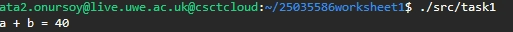

### `task1_2.asm` 
Extends the first task by asking the user for two integers using `read_int`.
* Each integer returned in `eax` is saved into an uninitialised variable (`resd 1`) in `.bss` so it is not lost while prompting for the second number.
* Both numbers are then added together and printed.

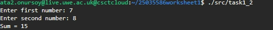

### Task 1 & 1.2 Verification
Running both programs in the terminal outputs the expected sums (`40` and `44`):

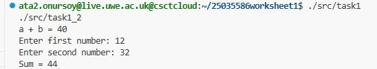

> **Quick Summary:** We bypassed standard C libraries to see how a CPU boots up from scratch. Using raw assembly, we loaded `0xCAFEBABE` into the `eax` register, took inputs from the user, safely stored them in `.bss`, and performed basic addition.
---

## Task 2: Loops, Conditionals, and Arrays 

### `task2_1.asm`: Input Validation & Welcome Loop
This task reads the user's name and prints a welcome message a given number of times if the count is between 50 and 100.
* **Reading Name:** Characters are read one by one using `read_char` in a loop until the enter key (`ASCII 10`) is pressed, then a null terminator (`0`) is added to end the string.
* **Bounds Check:** We check that `50 < count < 100` using `cmp` with signed jumps (`jle too_small` and `jge too_big`).
* **Looping:** When valid, the count is loaded into `ecx`, and the `loop` instruction handles decrementing `ecx` and jumping back until `ecx == 0`.

```nasm
cmp  eax, 50
jle  too_small          ; jump if count <= 50
cmp  eax, 100
jge  too_big            ; jump if count >= 100

mov  ecx, [count]
print_loop:
    ; print prefix, name buffer, and newline
    loop print_loop     ; decrements ecx and branches until 0
```
### Test Runs (Valid, Too Small, and Too Large Inputs):
* **Valid Input (60):** The program verifies that the entered number is between 50 and 100, enters a loop, and prints the name to the screen the specified number of times (`60 times`).
* **Too Small Input (10):** When a number below the lower bound is entered (`10`), the program outputs `Error: number too small` and terminates.
* **Too Large Input (150):** When a number above the upper bound is entered (`150`), the program displays `Error: number too large` as a warning.

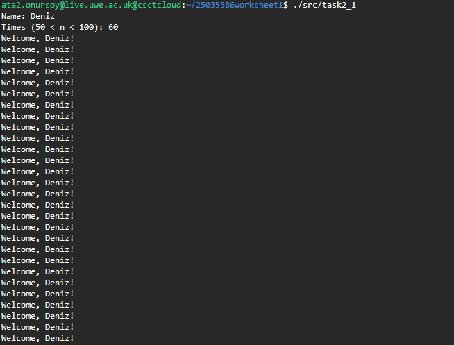
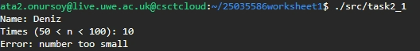
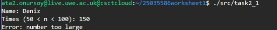

### `task2_2.asm`: Array Initialisation & Summation (1 to 100)
An array of 100 double-words (`resd 100`) is reserved in `.bss`.
* A loop runs from index `0` to `99` using `ecx` as the counter.
* Because each 32-bit integer occupies 4 bytes in memory, we access elements using base-index addressing: `[array + ecx*4]`.
* Elements are filled with `ecx + 1` (values 1 to 100) using `lea`, and added together to get the total sum of `5050`.

```nasm
lea  eax, [ecx+1]             ; calculate element value (1 to 100)
mov  [array + ecx*4], eax     ; store at 4-byte offset
```

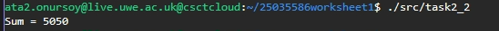
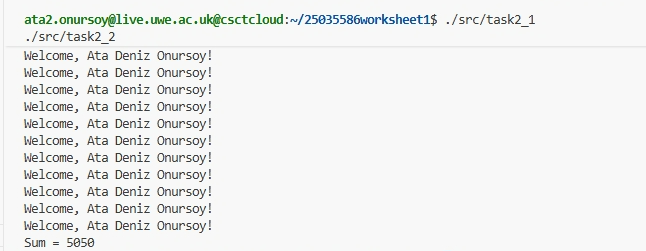

> **Quick Summary :** We implemented conditional branching (`cmp`, `jl`, `jg`) to validate user input within the strict range of `50 < n < 100`. If valid, it loops and prints the name; otherwise, it throws an error. For arrays, we used pointer arithmetic (`ecx*4`) to fill values from 1 to 100 and calculated the total sum.

### `task2_3.asm`: Range Sum with Bounds Checking
Extends `task2_2` by asking the user to provide a `start` and `end` index.
* **Validation:** The range is checked to make sure `1 <= start <= end <= 100`. Any input breaking this condition prints `Error: invalid range`.
* **Index Offset:** Since array indices start at 0, summation starts from `[array + (start - 1) * 4]`.

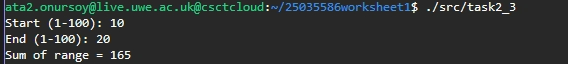
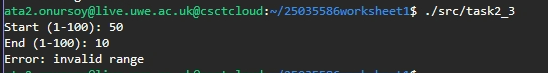

**What we did** We expanded our array program to take custom start and end positions from the user. We added boundary checks to prevent out-of-bounds reading and used pointer offsets ((start - 1) * 4) to sum up only the selected range.
---


## Task 3: Makefile Build Automation

A root `Makefile` automates compiling and linking all programs instead of running manual terminal commands.

* **Default Target (`all`):** Builds all five executables (`task1`, `task1_2`, `task2_1`, `task2_2`, `task2_3`).
* **Pattern Rules:** Compiles `.asm` files into `.o` files with `nasm -f elf -I src/`.
* **Linking:** Uses `gcc -m32` to link the C driver (`driver.o`), the task object file, and `asm_io.o` into a 32-bit executable.
* **Clean Rule:** `make clean` deletes all generated `.o` files and compiled binaries.

```bash
ata2.onursoy@live.uwe.ac.uk@csctcloud:~/25035586worksheet1$ make clean && make
```

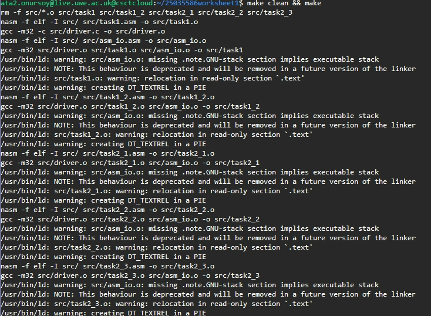

---
> **Quick Summary (What we did):** Instead of compiling files manually every time, we set up an automated Makefile. It handles compiling assembly and C files independently, linking them together into a final bootable binary (`kernel.elf`), and includes a clean rule.

## Task 4: Documentation & Practical Notes

This `README.md` documents the code implementations, design decisions, and test outputs for all worksheet tasks.

### Implementation Details
1. **Calling Convention:** 
    The assembly functions follow the standard 32-bit `cdecl` convention, with `driver.c` setting up and cleaning the stack.

2. **Register Usage:** 
    Functions from `asm_io` (such as `print_string` and `read_int`) use `eax` for passing and returning values, so values that need to be saved are kept in `ebx` or memory.

3. **Buffer Limit:** 
    Security Risk: Exceeding 63 characters causes extra bytes to bleed into adjacent .bss memory or overwrite stack framing data (Buffer Overflow vulnerability).

    Mitigation: Safe production code must strictly bound input loops or utilize length-checked inputs (such as fgets semantics) to preserve memory integrity and protect against stack corruption exploit vectors.

4. **Linker Warnings:** 

    Technical Context: Legacy 32-bit asm_io object files omit explicit stack execution markers. Modern OS kernels enable the NX/XD (No-Execute) bit memory protection mechanism by default to prevent arbitrary shellcode execution on the stack.

    Impact: Since our code executes solely within .text and stores data in .data/.bss, binaries run without issue despite missing stack metadata flags.