# UFCFWK-15-2 Operating Systems - Worksheet 1: An Echo of Assembler

Student Worksheet Submission for **UFCFWK-15-2 Operating Systems**[cite: 4].  
This repository contains the 32-bit x86 NASM assembly implementations, C driver integration, build automation, and test run logs completed on `csctcloud.uwe.ac.uk`[cite: 4, 6].

---

## Environment & Build Setup

The development environment is a 64-bit Linux server (`csctcloud`), so compiling 32-bit binaries requires `nasm -f elf` and `gcc -m32`[cite: 1, 4, 6]. The C runtime starts in `src/driver.c`, which calls our assembly code through `asm_main` using the standard `cdecl` calling convention[cite: 6].

### Project Directory Structure
The repository is laid out according to the worksheet instructions, keeping source files in `src/` and output screenshots in `Images/`[cite: 3, 5]:

```text
25035586worksheet1/
├── Makefile
├── README.md
├── Images/
│   ├── vscode-structure.png
│   ├── make.png
│   ├── task1.png
│   ├── task1_2.png
│   ├── task1_test.png
│   ├── task2_1.png
│   ├── task2_1_test.png
│   ├── task2_1_small.png
│   ├── task2_1_big.png
│   ├── task2_2.png
│   ├── task2_2_success.png
│   ├── task2_3.png
│   └── task2_3_bad.png
└── src/
    ├── asm_io.asm
    ├── asm_io.inc
    ├── driver.c
    ├── task1.asm
    ├── task1_2.asm
    ├── task2_1.asm
    ├── task2_2.asm
    └── task2_3.asm
```

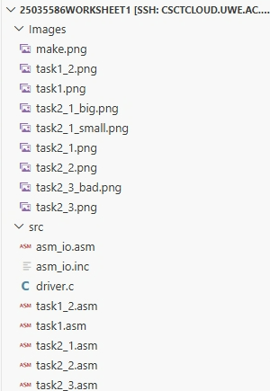

To clean and compile all targets from scratch[cite: 1]:
```bash
make clean && make
```

---

## Task 1: Basic Assembly & Calling C from Assembler (20%)

Task 1 focuses on writing basic assembly routines that can be called from a C program via `driver.c`[cite: 5, 6].

### `task1.asm` (Slide 18)
This program adds two hardcoded integers defined in `.data` (`a` and `b`) and prints the result using `print_int`[cite: 5, 6].
* Square brackets (`[a]`) are used to dereference the label and read the stored integer value rather than its memory address[cite: 2].
* Because calling `print_string` modifies `eax`, the calculated sum is temporarily saved in `ebx` and moved back into `eax` before calling `print_int`[cite: 2].

```nasm
mov  eax, [a]       ; load value of a
add  eax, [b]       ; add value of b
mov  ebx, eax       ; save sum in ebx (print_string overwrites eax)
mov  eax, msg       ; load address of the string
call print_string
mov  eax, ebx       ; restore sum into eax
call print_int
```

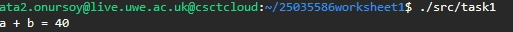

### `task1_2.asm` (Slide 22)
Extends the first task by asking the user for two integers using `read_int`[cite: 2, 6].
* Each integer returned in `eax` is saved into an uninitialised variable (`resd 1`) in `.bss` so it is not lost while prompting for the second number[cite: 2].
* Both numbers are then added together and printed[cite: 2].

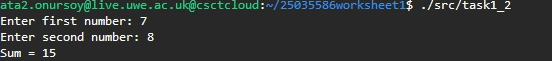

### Task 1 & 1.2 Verification
Running both programs in the terminal outputs the expected sums (`40` and `44`)[cite: 1, 2]:

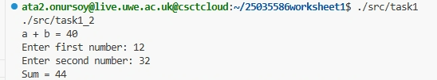

---

## Task 2: Loops, Conditionals, and Arrays (20%)

### `task2_1.asm`: Input Validation & Welcome Loop
This task reads the user's name and prints a welcome message a given number of times if the count is between 50 and 100[cite: 3, 7].
* **Reading Name:** Characters are read one by one using `read_char` in a loop until the enter key (`ASCII 10`) is pressed, then a null terminator (`0`) is added to end the string[cite: 3].
* **Bounds Check:** We check that `50 < count < 100` using `cmp` with signed jumps (`jle too_small` and `jge too_big`)[cite: 3, 7].
* **Looping:** When valid, the count is loaded into `ecx`, and the `loop` instruction handles decrementing `ecx` and jumping back until `ecx == 0`[cite: 3, 7].

```nasm
cmp  eax, 50
jle  too_small          ; jump if count <= 50
cmp  eax, 100
jge  too_big            ; jump if count >= 100

mov  ecx, [count]
print_loop:
    ; print prefix, name buffer, and newline
    loop print_loop     ; decrements ecx and branches until 0
```

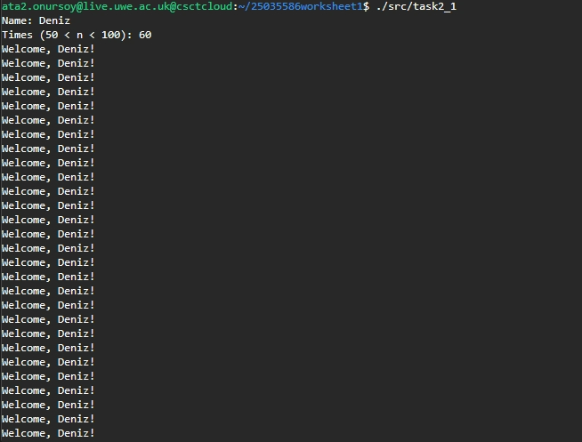

**Test Runs (Valid: 60, Too Small: 10, Too Large: 150):**

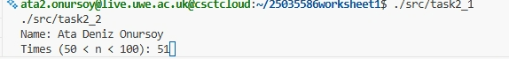
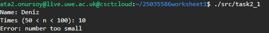
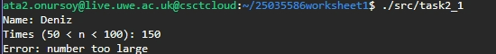

### `task2_2.asm`: Array Initialisation & Summation (1 to 100)
An array of 100 double-words (`resd 100`) is reserved in `.bss`[cite: 3, 7].
* A loop runs from index `0` to `99` using `ecx` as the counter[cite: 3].
* Because each 32-bit integer occupies 4 bytes in memory, we access elements using base-index addressing: `[array + ecx*4]`[cite: 3, 7].
* Elements are filled with `ecx + 1` (values 1 to 100) using `lea`, and added together to get the total sum of `5050`[cite: 3].

```nasm
lea  eax, [ecx+1]             ; calculate element value (1 to 100)
mov  [array + ecx*4], eax     ; store at 4-byte offset
```

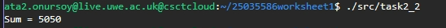
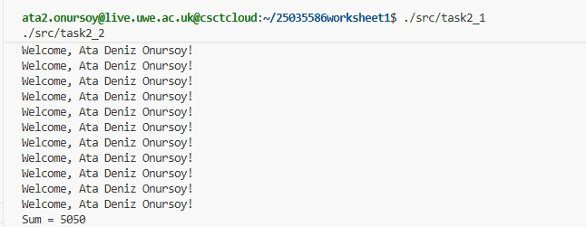

### `task2_3.asm`: Range Sum with Bounds Checking
Extends `task2_2` by asking the user to provide a `start` and `end` index[cite: 1, 7].
* **Validation:** The range is checked to make sure `1 <= start <= end <= 100`[cite: 1, 7]. Any input breaking this condition prints `Error: invalid range`[cite: 1].
* **Index Offset:** Since array indices start at 0, summation starts from `[array + (start - 1) * 4]`[cite: 1].

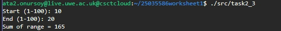
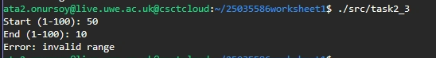

---

## Task 3: Makefile Build Automation (20%)

A root `Makefile` automates compiling and linking all programs instead of running manual terminal commands[cite: 1, 7, 8].

* **Default Target (`all`):** Builds all five executables (`task1`, `task1_2`, `task2_1`, `task2_2`, `task2_3`)[cite: 1, 8].
* **Pattern Rules:** Compiles `.asm` files into `.o` files with `nasm -f elf -I src/`[cite: 1].
* **Linking:** Uses `gcc -m32` to link the C driver (`driver.o`), the task object file, and `asm_io.o` into a 32-bit executable[cite: 1].
* **Clean Rule:** `make clean` deletes all generated `.o` files and compiled binaries[cite: 1, 7].

```bash
ata2.onursoy@live.uwe.ac.uk@csctcloud:~/25035586worksheet1$ make clean && make
```

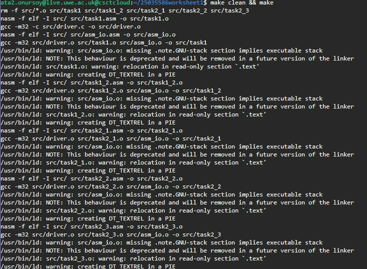

---

## Task 4: Documentation & Practical Notes (40%)

This `README.md` documents the code implementations, design decisions, and test outputs for all worksheet tasks[cite: 4, 8].

### Implementation Details
1. **Calling Convention:** The assembly functions follow the standard 32-bit `cdecl` convention, with `driver.c` setting up and cleaning the stack[cite: 6].
2. **Register Usage:** Functions from `asm_io` (such as `print_string` and `read_int`) use `eax` for passing and returning values, so values that need to be saved are kept in `ebx` or memory[cite: 2, 3].
3. **Buffer Limit:** The user name buffer in `task2_1` is set to 64 bytes (`resb 64`)[cite: 3]. If an input exceeds 63 characters, it will overflow into adjacent memory[cite: 3].
4. **Linker Warnings:** During `make`, the linker gives warnings about `.note.GNU-stack` and `DT_TEXTREL`[cite: 1]. This happens because the legacy 32-bit `asm_io` routines lack modern non-executable stack flags, but this is expected and does not impact program execution[cite: 1, 2, 3].